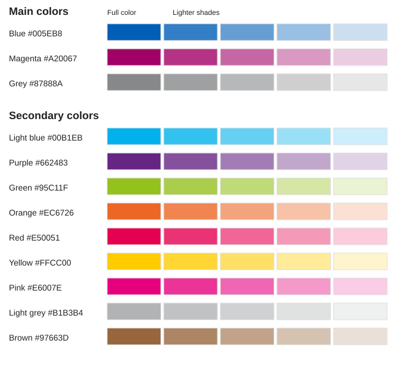

# Axians Color Guide
-----------------------------------------------------

This guide is based on the Axians Color Guide 2024. Use these colors when creating Axians-branded Power BI reports and mock-ups.

**Color examples:**



The first square in each row is the full brand color. The other squares show approximate lighter shades, made by mixing the color with white.

**Main colors:**

| Color | HEX | RGB | CMYK | Pantone |
| --- | --- | --- | --- | --- |
| Blue | `#005EB8` | 0, 94, 184 | 100, 50, 0, 0 | 300 C |
| Magenta | `#A20067` | 162, 0, 103 | 20, 100, 5, 20 | 234 C |
| Grey | `#87888A` | 135, 136, 138 | 0, 0, 0, 60 | Not specified |

**Secondary colors:**

| Color | HEX | RGB | CMYK |
| --- | --- | --- | --- |
| Light blue | `#00B1EB` | 0, 177, 235 | 80, 0, 0, 0 |
| Purple | `#662483` | 102, 36, 131 | 75, 100, 0, 0 |
| Green | `#95C11F` | 149, 193, 31 | 50, 0, 100, 0 |
| Orange | `#EC6726` | 236, 103, 38 | 0, 70, 90, 0 |
| Red | `#E50051` | 229, 0, 81 | 0, 100, 50, 0 |
| Yellow | `#FFCC00` | 255, 204, 0 | 0, 20, 100, 0 |
| Pink | `#E6007E` | 230, 0, 126 | 0, 100, 0, 0 |
| Light grey | `#B1B3B4` | 177, 179, 180 | 0, 0, 0, 40 |
| Brown | `#97663D` | 151, 102, 61 | 40, 60, 80, 15 |

# How to:

**When you want to use a color in Power BI:**
1. Select the page or visual you want to format
2. Open the formatting options and select the color you want to change
3. Enter a HEX code from the tables above, for example `#005EB8` for the main blue
4. Check the result in your report and save your changes

**When you want to use a color with GitHub Copilot:**
1. Open Copilot Chat in Visual Studio Code
2. Include the color and HEX code in your request. For example:

   ```text
   Change the chart colors to Axians main blue (#005EB8)
   and Axians magenta (#A20067). Keep the existing data and layout.
   ```

3. Review the proposed changes and check the report in Power BI Desktop
